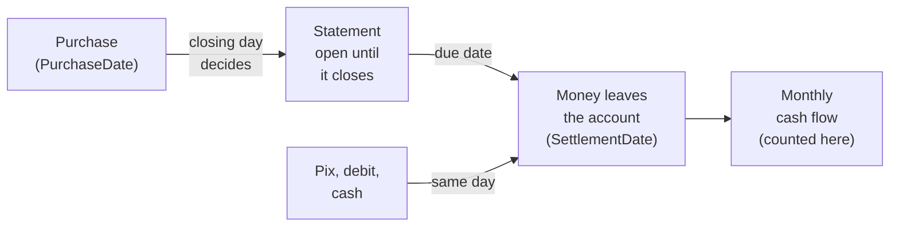
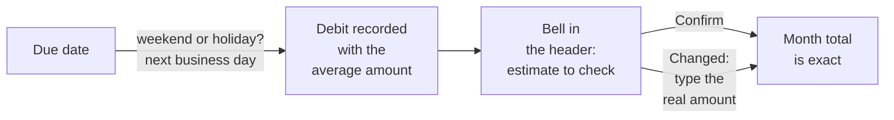
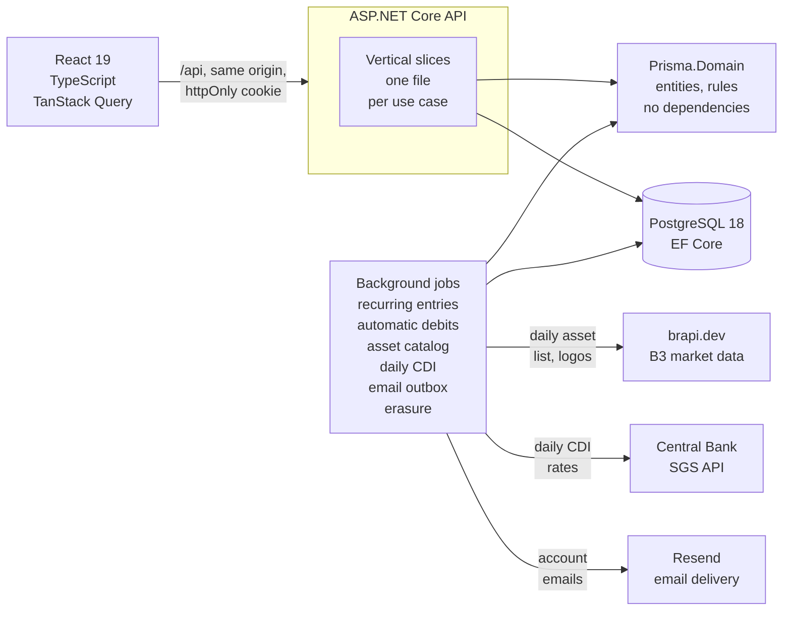
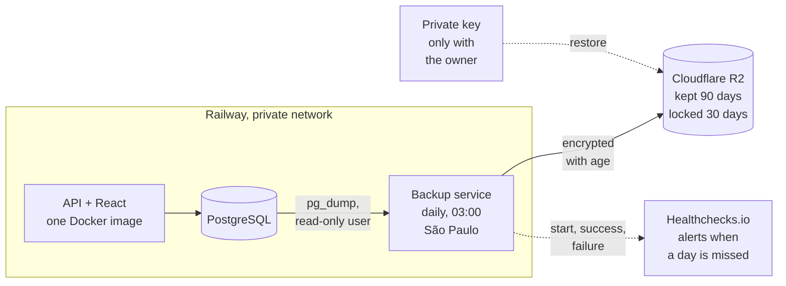
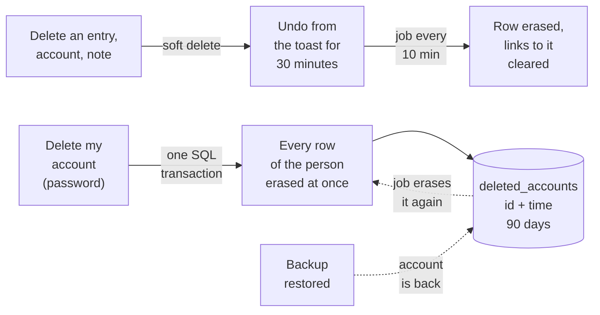

# Prisma

Public name: **Prisma Money**. The code keeps `Prisma`.

**Personal finance built for how money actually moves in Brazil:** Pix, credit card statements with
real closing and due dates, installments that never lose a cent, and refunds that behave like refunds.

[](https://github.com/vagnerwentz/prisma/actions/workflows/ci.yml)


The CI badge covers the whole pipeline: backend unit, property, integration and architecture tests,
frontend lint, unit tests and production build, and a backup round trip (dump, encrypt, restore,
compare). Deploys only happen when it is green.

## Why

Most finance apps treat a credit card purchase as money spent the day you swipe. In Brazil that is
rarely true: the purchase lands on a statement, the statement closes on a date the bank decides, and
the money leaves your account on the due date, sometimes split into installments. Prisma models that
reality, so the monthly numbers match your bank account instead of your receipts.

## What it does

- **Accounts:** checking, cash, investments and credit cards, with balances.
- **Credit card statements:** each purchase lands on the right statement from the card's closing and
  due days; statement dates can be adjusted when the bank moves them.
- **Aligned with the bank:** a purchase the bank posted to the next statement can be moved there
  (installment purchases move whole), and adjusting a statement's dates shows, before saving, which
  purchases would change statements. Both come with one-tap undo.
- **Wrong card? Change it:** a purchase logged on the wrong card moves to the other card's
  statements (installments move together), with the money leaving on the new due date.
- **Recurring entries:** a weekly or monthly Pix, or a charge a company makes on the card every month.
  Each occurrence is recorded only on its day; what is still to come shows up as a lighter projection in
  the months ahead and on the open statement, never in balances. A charge that would land on an
  already-paid statement waits for a decision instead of changing it.
- **Automatic debits:** utility bills the bank debits from a checking account. The debit lands on the
  next business day after the due date (weekends and national holidays). When the bill changes every
  month, the debit is recorded with an average amount, marked as an estimate everywhere it shows, and
  waits in a bell in the header until you confirm it or type the real amount.
- **Installments:** R$ 100.00 in 3x is 33.34 + 33.33 + 33.33, always adding up to the total.
- **Refunds** reduce spending in the month they land and are never counted as income.
- **Transfers** (including paying a card statement) are never income or expense, so nothing is
  counted twice.
- **Investments:** a portfolio of B3 stocks, REITs (FIIs) and ETFs picked from a catalog synced daily, and the
  payouts each one made (dividends, interest on equity, fund income), recorded as income in the account where the
  money landed. Brokerage notes are typed in (buys, sells and their fees, with the brokerage fee charged only on the
  asset types the note says); quantity, average price with and without costs, and realized results are recalculated
  from them on every read, never stored. Corporate events come from a curated shared catalog and apply on their record
  date, for everyone holding the asset: splits and reverse splits, conversions that carry the cost over, and fund
  liquidations paid in units of another fund, where the old position closes as a sale and the new units cost the
  official reference price. Each person confirms once what an event did to their own quantity, or reports that it does
  not match, which goes to the curator without changing anything on its own. An asset missing from the catalog can be
  reported in one tap, and the app says when it arrives. Company logos are downloaded, sanitized and served by the app itself.
- **Portfolio by year:** how much is invested (at cost) at the end of any year, or today, split by asset type and drawn
  as light leaving a prism, one band per type; each asset's weight; payouts month by month and year by year, filtered
  by payout type and asset type, with what is still to be received kept apart.
- **Fixed income by goal:** goals ("boxes", such as an emergency fund or a trip) hold CDB deposits that earn a
  percentage of the CDI, typed in by hand. The yield is calculated from the official daily CDI published by the Central
  Bank, using the B3 convention in integer math and checked against real bank statements to within one cent. A deposit
  can come out of an account, which creates the transfer with it (income and expense never change, "invested" goes up).
  Each goal shows its balance, a chart of its evolution and the yield of every deposit; a switch shows gross values or an
  estimate net of tax (IOF under 30 days and the regressive income tax, per deposit, as if it were redeemed today).
  A deposit can be redeemed in full or in part: the principal and the yield come out in proportion, the tax is
  calculated (or taken from the bank statement, if you type it in), and the money can land in one of your accounts as a
  transfer of the principal plus income for the net yield. Redeemed deposits are listed apart and leave the balance.
  Nothing is projected: it always says up to which day the rates go, and warns when they are late or incomplete.
  In the portfolio it is one group, "Fixed income", weighted by the amount still invested, with one line per goal.
- **Cash-flow dashboard:** what came in, what went out and what was invested each month, by
  settlement date; category breakdown, month-over-month explanation and upcoming commitments.
- **Categories:** a default set per user that evolves: new default categories reach existing users
  once, without undoing their renames or deletions.
- **Undo everywhere, then really gone:** deleting is a soft delete, restorable from the toast for 30 minutes; after that
  a background job erases the row for good.
- **Delete my account:** one screen, the password, and every row of the person leaves the database at once.
- **Privacy policy and terms of use** as static pages (`/privacidade`, `/termos`): Markdown in the repository turned
  into HTML at build time, no JavaScript, no cookies. Sign-up requires accepting them (and being 18 or older); the
  accepted versions are stored, and a new version asks existing users to accept again when they sign in.
- **Account by email:** sign-up is confirmed by an emailed link, a forgotten password is replaced through a one-hour
  link, the password can be changed from the account menu (this device stays signed in, the others leave), and every
  security change is announced by email. The emails share the app's look: an ink header, the spectrum
  stripe and a document-like layout that holds up in Gmail, Outlook and dark mode.

## Engineering highlights

- **Money is an integer.** Amounts are `long` cents behind a `Money` value object; splitting into
  installments distributes the remainder and is verified by property-based tests over thousands of
  inputs.
- **Two dates per transaction.** `PurchaseDate` (when it happened) and `SettlementDate` (when the
  money leaves). Dates are `DateOnly` in `America/Sao_Paulo`, behind an `IClock`; an architecture test
  fails the build if any code reads the system clock directly.
- **Rich domain, thin handlers.** Business rules live in a domain project with no infrastructure
  dependencies (enforced by NetArchTest). API handlers load, delegate and save.
- **Isolation by default.** Every user row belongs to a user and a global query filter scopes every query;
  an architecture test forbids bypassing it, and another one rejects any table that has no owner unless it
  is on a short, explicit list of shared tables (login data and market data, including the daily CDI rates).
- **Concurrency on purpose.** Statements use PostgreSQL's `xmin` as a concurrency token, with race
  tests: paying a statement while a purchase moves into it returns 409 instead of a wrong total.
- **A background job that cannot duplicate.** Recurring entries are generated by an in-process
  `BackgroundService` that acts as each user (same query filters as a request). The entry and the
  series' progress are saved together, a unique index covers even deleted occurrences, and `xmin`
  guards the series: running twice, concurrently or after downtime catches up without duplicates.
- **A bank calendar with nothing to maintain.** Business days come from weekends, fixed national holidays
  and the ones computed from Easter (Carnival, Good Friday, Corpus Christi). Property-based tests check it
  across a century, and an architecture test limits which code may use it: only automatic debits and card
  due dates move to a business day; everything else keeps the date it happened.
- **Third-party data at arm's length.** The B3 asset list comes from an external provider behind an interface, synced
  once a day into a shared catalog: a list that suddenly shrinks is refused, assets that disappear are deactivated and
  never deleted, and tests replay recorded real responses instead of calling the provider. Company logos are SVGs from
  that provider, so they are sanitized (no scripts, external references or foreign elements) and served by the app
  under a locked-down content security policy.
- **Yield you can audit.** The fixed-income engine is pure domain code in `Int128` fixed point (no `decimal` or
  `double`), with the daily factor truncated at 16 places and rounded at 8 like the B3 does. Its expected values come
  from an independent calculation and from two real bank statements, and property tests compare it with a
  second implementation in arbitrary-precision integers. The estimated tax is a separate, dated rule set, so a change in
  the law becomes a new rule instead of a rewrite.
- **Market data that lies politely.** The Central Bank API has answered the same bad query with a 406, with a 200 and a
  JSON error, and once with a 200 and an HTML page, and answers an empty range with a 404. The client accepts only a
  JSON array and refuses the whole batch otherwise; the sync is idempotent, serialized by an advisory lock, never fills a
  missing day with zero, and the domain reports whether the history is late or has a gap so the screen can say so.
- **Percentages that add up.** Portfolio weights are integers in hundredths of a percent, distributed by the largest
  remainder so they always total exactly 100%, verified by property-based tests. Per-unit prices from official
  documents keep eight decimal places, and only the final amount becomes cents.
- **Tests that prove themselves.** Rules about money and dates are tested before they are written,
  integration tests run against a real PostgreSQL (Testcontainers, never an in-memory provider), and
  new rules are checked by breaking them on purpose and watching a test fail.
- **Email that never blocks a request.** Emails go through an outbox table written in the same transaction as their
  reason, and a background worker sends them with growing retry delays for up to 24 hours: the provider being down
  never fails a sign-up. The provider (Resend, over plain HTTP) sits behind an interface, and no link or token is ever
  stored: content is built at send time.
- **Account flows that reveal nothing.** Sign-up, "forgot password" and "resend" answer the same whether or not an
  account exists. Links are signed, single-use, short-lived and carried after the `#`, so they never reach a server
  log. Confirming asks for the sign-up password, which closes account pre-hijacking (someone registering a victim's
  address first); resetting the password through the email confirms the account and locks the intruder out.
- **A lockout that forgets.** Five wrong passwords lock the account for 15 minutes, counted together across sign-in,
  email confirmation, password change and account deletion. A wrong password only adds up if it comes within 15
  minutes of the previous one, so a typo a week never locks anyone out.
- **Erasure that survives a restore.** Deleted account ids are kept for the 90 days that backups live; restoring an
  older backup brings those accounts back, and the job erases them again. Schema-reading tests fail when a new table
  with an owner or a soft delete is left out of the erasure.
- **Structured logs** with source-generated `LoggerMessage` events, one JSON line per event, and a
  test that refuses events carrying amounts, descriptions, names, emails or tokens.
- **Backups that have been restored, not just taken.** A daily job dumps the database as a read-only
  user, encrypts it with `age` before it leaves the container (the private key never touches the
  server) and stores it off the hosting provider, under a deletion lock. A truncated dump is never
  uploaded, a missed day sends an alert, and CI restores a backup on every push and compares it row by
  row. A restore drill has been run against production.

## How money moves

A card purchase is not money spent on the day you swipe. It lands on a statement, and the money leaves on
the statement's due date. That due date is the date the dashboard counts.



An automatic debit repeats every month on its own. When the amount changes, the app records the average
and asks you to check it:



## Architecture



- **`src/Prisma.Domain`:** entities, value objects and rules; no EF Core, ASP.NET Core or Npgsql.
- **`src/Prisma.Api`:** one file per use case (request, validator, handler and endpoint together),
  EF Core configuration, migrations, authentication.
- **`src/prisma-web`:** React app, served by the API in production (same origin, no CORS), plus a static
  landing page (`landing.html`, React prerendered at build time) shown at `/` to visitors without a session while sign-up is open.
  The privacy policy and terms of use are Markdown files rendered to static HTML at build time (`/privacidade`, `/termos`).
- **`tests/`:** domain, integration and architecture tests.

In production the API and the React build ship as one Docker image on Railway, with migrations applied
on startup and deploys gated on CI. A second service in the same project backs the database up every
night:



The backup lives outside Railway on purpose: losing the hosting account must not take the backups with it.

Deleting is undoable for a while, then final. The same job keeps the promise after a backup is restored:



## Tech stack

| Layer | Technology |
|---|---|
| Backend | .NET 10, ASP.NET Core Minimal APIs, EF Core 10 + Npgsql, FluentValidation |
| Auth | ASP.NET Core Identity, `httpOnly` secure cookie, rate limiting, lockout with a time window, email confirmation, password reset and change |
| Email | Resend over a typed `HttpClient` (no SDK), Postgres outbox, table-based HTML templates |
| Database | PostgreSQL 18 |
| Frontend | React 19, TypeScript, Vite, TanStack Query, React Hook Form + Zod, Tailwind CSS, shadcn/ui |
| API client | `openapi-typescript` + `openapi-fetch`, types generated from the OpenAPI document |
| Tests | xUnit, Shouldly, CsCheck, Testcontainers, NetArchTest, Vitest |
| Hosting | Railway (Docker), deploys gated on CI |
| Market data | brapi.dev (B3 asset list and logos) and the Central Bank SGS API (daily CDI), typed `HttpClient`, no SDK |
| Backups | `pg_dump` + `age` + `rclone` (Alpine image), Cloudflare R2, Healthchecks.io |

## Getting started

Requirements: .NET 10 SDK, Node.js, Docker.

```bash
dotnet tool restore
cp .env.example .env          # then set a database password
dotnet user-secrets set "ConnectionStrings:Default" \
  "Host=localhost;Port=5432;Database=prisma;Username=prisma;Password=<password from .env>" \
  --project src/Prisma.Api

docker compose up -d           # PostgreSQL
dotnet ef database update -p src/Prisma.Api -s src/Prisma.Api
dotnet run --project src/Prisma.Api

cd src/prisma-web
npm install
npm run dev                    # http://localhost:5173, proxies /api to the API
```

Tests:

```bash
dotnet test                    # domain, integration (needs Docker) and architecture
cd src/prisma-web && npm test  # frontend

# backup round trip (needs Docker): the schema comes from the migrations
dotnet ef migrations script --idempotent -p src/Prisma.Api -s src/Prisma.Api -o /tmp/schema.sql
ops/backup/test/roundtrip.sh /tmp/schema.sql
```

## Project documents

The roadmap (`PLAN.md`), the phase specifications (`docs/`, including `docs/renda-fixa.md` for fixed income: formulas,
sources and decisions; `docs/admin-mercado.md` for the market-data admin, where the CDI sync can be triggered by hand; `docs/renda-fixa-ipca.md` for the planned inflation-indexed products), the operations runbook (`docs/operacao.md`: database users, backups, restore, logs, the CDI sync)
and the working agreement (`CLAUDE.md`)
are working documents written in Portuguese.

## License

Copyright © 2026 Vagner Wentz. All rights reserved.

This repository is public so the code can be read. No license is granted: it may not be copied,
modified, distributed or used, in whole or in part, without written permission.
